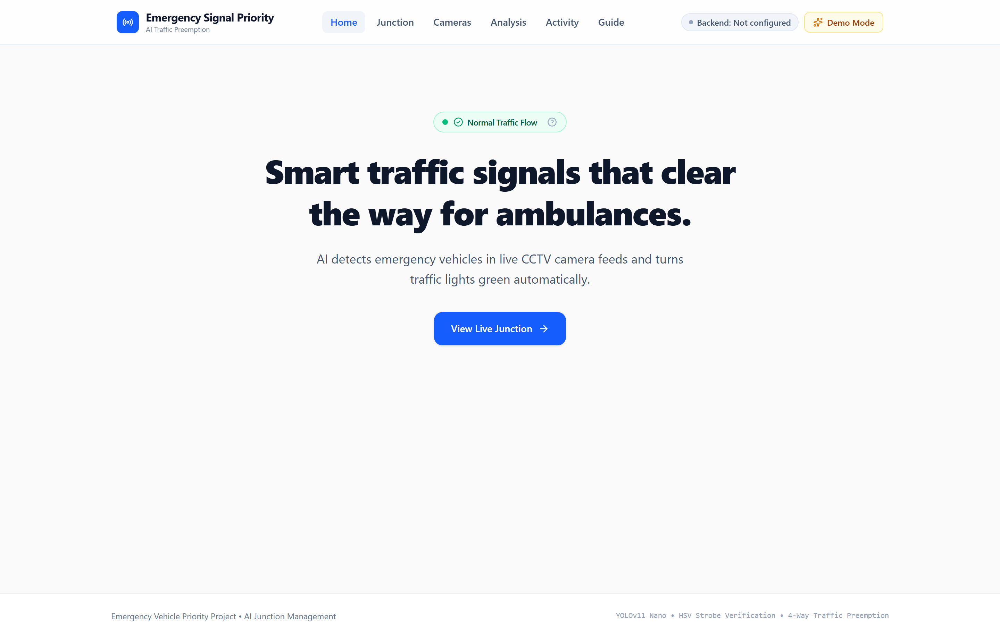
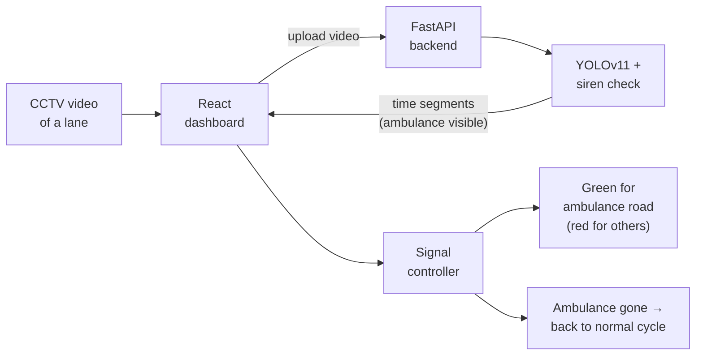
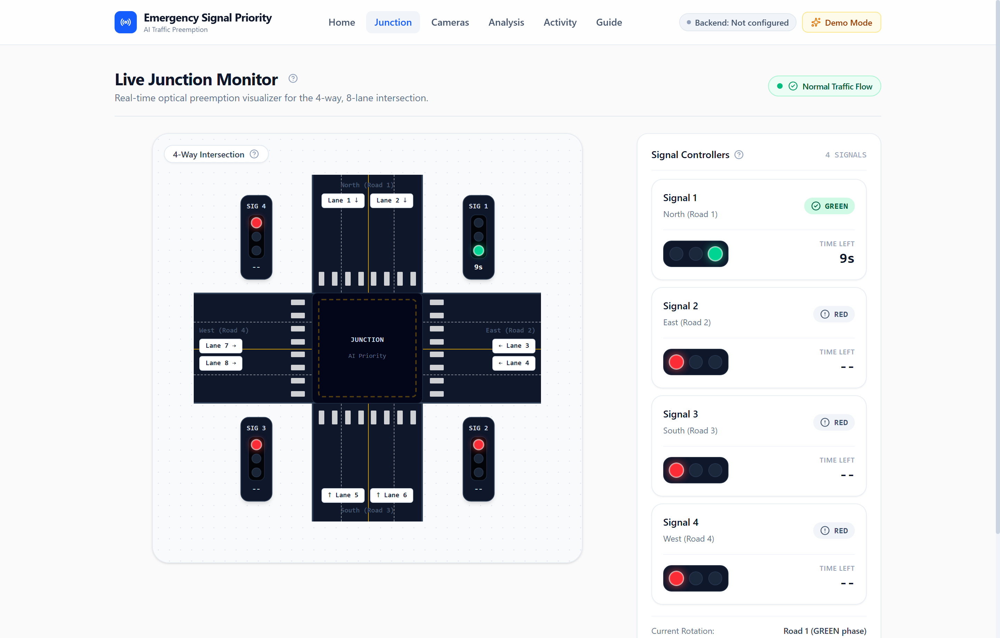
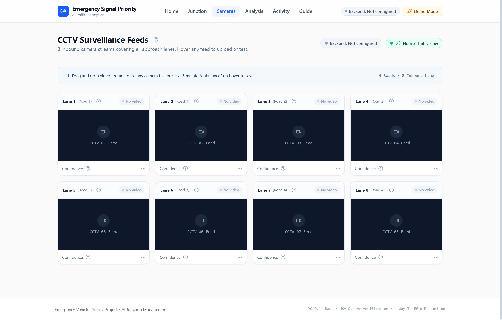
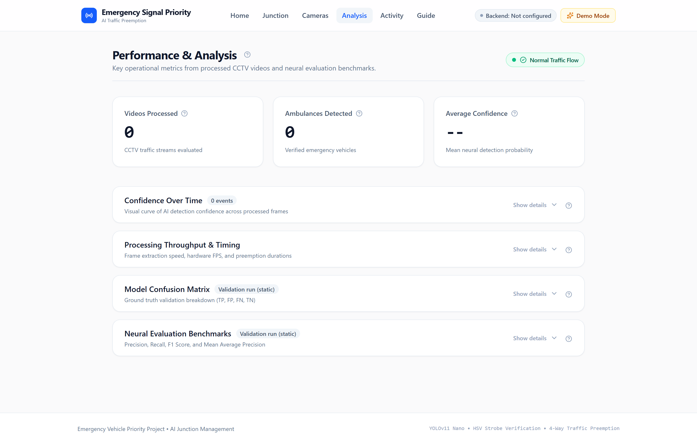
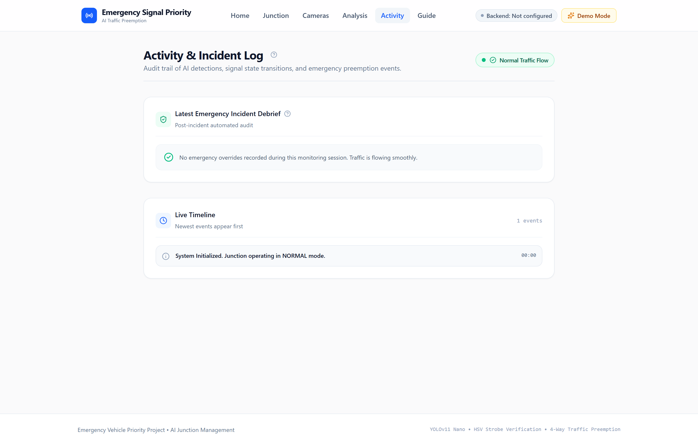
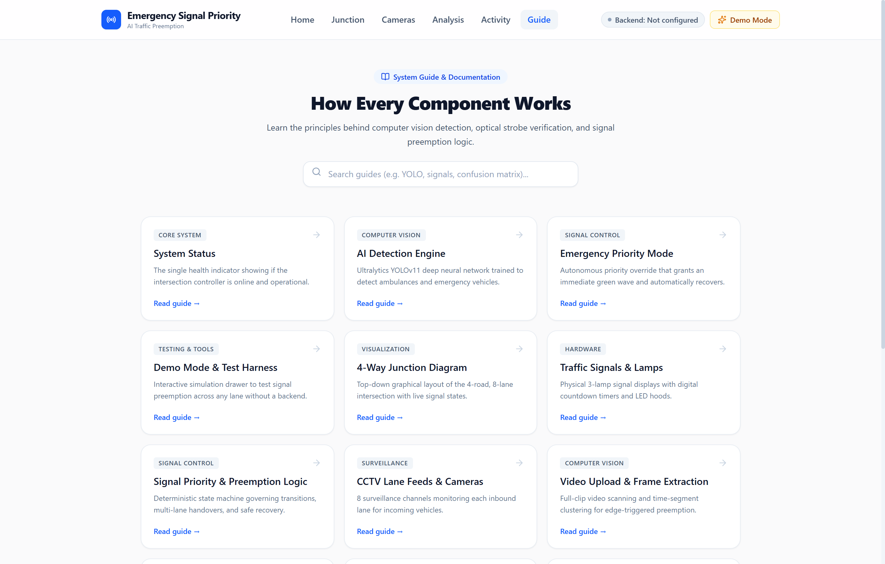
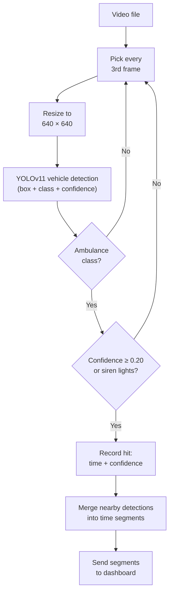
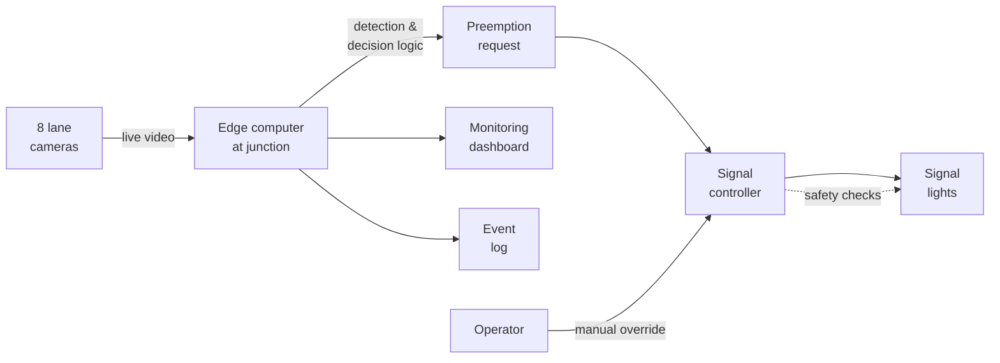

# 🚑 Emergency Vehicle AI Detection

**AI that spots ambulances in CCTV footage and turns the traffic light green for them. When the ambulance has passed, the junction goes back to normal by itself.**



**On this page:** [What it does](#what-it-does) · [How it works](#how-it-works) · [Features](#features) · [Screenshots](#screenshots) · [Try it on your own computer](#try-it-on-your-own-computer) · [Settings](#settings-you-can-change) · [Project structure](#project-structure) · [Backend API](#backend-api) · [Model results](#model-results) · [Tests](#run-the-tests) · [Limitations](#limitations-and-future-work) · [Credits](#credits-and-license)

---

## What it does

At a busy junction, an ambulance can lose precious minutes stuck at a red light. This project watches 8 camera lanes at a 4-way junction. When the AI finds an ambulance in a lane, the traffic signals switch immediately so the ambulance's road gets a green light. A few seconds after the ambulance has gone, the junction returns to its normal cycle. No one has to press a button.

## How it works



1. You upload a video to one of the 8 lane cameras.
2. The backend scans the video with a YOLOv11 model and also checks for flashing red/blue siren lights, which reduces false alarms.
3. It returns the time ranges in which an ambulance is visible.
4. The dashboard plays the video and compares the playback time with those ranges. When the ambulance appears, the controller gives that road priority green and sets the other roads to red.
5. When the ambulance has been gone for 1.5 seconds, a 3-second safety buffer runs and the normal signal cycle resumes.

## Features

- **Live junction view:** a 4-road, 8-lane intersection with 4 signals and countdown timers.
- **8 CCTV lane feeds:** upload a video to any lane, with a clear status per lane (No video, Analyzing, Clear, Ambulance).
- **Automatic emergency priority and automatic recovery:** no manual reset needed.
- **Analysis page:** videos processed, ambulances detected, confidence per detection, processing speed, confusion matrix and model metrics.
- **Activity log:** a timeline of every detection, signal change and recovery.
- **Demo Mode:** simulate an ambulance on any lane without a video. Simulated data is always labelled "Simulated".
- **Guide pages:** every component of the dashboard is explained in plain language.

## Screenshots

| Junction (normal) | Junction (emergency) |
|---|---|
|  |  |

| Cameras | Analysis |
|---|---|
|  |  |

| Activity log | Guide |
|---|---|
|  |  |

## Tech stack

| Part | Technology |
|---|---|
| Frontend | React 19, Vite, Tailwind CSS, Lucide icons |
| Backend | Python, FastAPI, Uvicorn |
| AI model | Ultralytics YOLOv11 (nano), OpenCV, HSV siren-light check |
| Tests | pytest (backend), Vitest (frontend) |
| Optional | Streamlit dashboard |

---

## Installation and Setup

Anyone can run this project on their own computer in about 15 minutes. Nothing is installed globally, you don't need an account, and everything stays on your machine.

The project has two parts, and each one runs in its own terminal window:

- the **backend** (the AI that analyses videos), and
- the **frontend** (the dashboard you see in the browser).

### Step 1: Install the prerequisites (one time)

| You need | Version | Get it from | Check it works |
|---|---|---|---|
| Python | 3.10, 3.11 or 3.12 | [python.org/downloads](https://www.python.org/downloads/) | `python --version` |
| Node.js (includes npm) | 18 or newer | [nodejs.org](https://nodejs.org/) | `node --version` |
| Git (optional) | any | [git-scm.com](https://git-scm.com/downloads) | `git --version` |

> **Windows tip:** when installing Python, tick **"Add python.exe to PATH"** on the first screen.
> **macOS / Linux tip:** you may need to type `python3` and `pip3` instead of `python` and `pip`.

### Step 2: Download the project

**Option A: with Git**

```bash
git clone https://github.com/ritamdeep/emergency-vehicle-ai-detection.git
cd emergency-vehicle-ai-detection
```

**Option B: without Git**

1. Open [the repository page](https://github.com/ritamdeep/emergency-vehicle-ai-detection).
2. Click the green **Code** button, then **Download ZIP**.
3. Unzip it and open the unzipped folder in a terminal (on Windows, right-click inside the folder and choose "Open in Terminal").

### Step 3: Start the backend (Terminal 1)

**Windows (PowerShell):**

```powershell
cd backend
python -m venv venv
venv\Scripts\activate
pip install -r requirements.txt
pip install fastapi uvicorn python-multipart
python api_server.py
```

**macOS / Linux:**

```bash
cd backend
python3 -m venv venv
source venv/bin/activate
pip install -r requirements.txt
pip install fastapi uvicorn python-multipart
python api_server.py
```

- The installation downloads PyTorch, which is large. Allow 5 to 10 minutes and a few GB of disk space.
- It is ready when you see **`Uvicorn running on http://0.0.0.0:8000`**. The first start takes a while because the model has to load.
- **Check it:** open <http://localhost:8000/health> in your browser. You should see `"status":"online"`.
- **Leave this terminal open.** Closing it stops the backend.

### Step 4: Start the dashboard (Terminal 2)

Open a **new** terminal window in the project folder:

```bash
cd frontend
npm install
npm run dev
```

Then open **<http://localhost:5173>** in your browser. You should see the home page.

### Step 5: Test it

Pick whichever test you like.

**Test A: 30-second check, no video needed**

1. Click **Demo Mode** (top right) to turn it on.
2. Go to the **Cameras** page and press **Simulate Ambulance** on any lane.
3. Go to the **Junction** page. That lane's road turns **green** and the other roads turn **red**.
4. Wait about 8 seconds. The junction goes back to its normal cycle **by itself**.
5. Open the **Activity** page to see every step logged.

**Test B: real AI detection with a video**

1. Make sure the backend from Step 3 is running. The Cameras page should show the detection server as **Online**.
2. On the **Cameras** page, upload `samples/demo-traffic.mp4` (it's in the project folder) to any lane, or drag your own short traffic video onto a lane tile.
3. Wait while the lane shows **Analyzing**. On an ordinary computer this takes a little while, so use clips of **10 to 20 seconds**.
4. The video starts playing. When an ambulance appears, the lane shows **Ambulance** and the **Junction** page switches that road to green.
5. About 1.5 seconds after the ambulance leaves the video, plus a 3-second safety buffer, the junction returns to normal on its own.
6. Open **Analysis** to see the detection confidence, processing time and model results.

> If the backend is not running, the dashboard says the detection server is unreachable. In Demo Mode it falls back to a **simulated** result, which is always labelled "Simulated".

### Step 6: Stop and start again

- **Stop:** press `Ctrl + C` in each terminal.
- **Next time:** you only need these commands.

| Windows | macOS / Linux |
|---|---|
| Terminal 1: `cd backend` then `venv\Scripts\activate` then `python api_server.py` | Terminal 1: `cd backend` then `source venv/bin/activate` then `python api_server.py` |
| Terminal 2: `cd frontend` then `npm run dev` | Terminal 2: `cd frontend` then `npm run dev` |

### Something went wrong?

| What you see | What to do |
|---|---|
| `python` is not recognized | Reinstall Python and tick "Add python.exe to PATH". On macOS/Linux, use `python3`. |
| PowerShell says "running scripts is disabled" | Run `Set-ExecutionPolicy -Scope CurrentUser RemoteSigned` once, then activate again. |
| `ModuleNotFoundError` in the backend | The virtual environment isn't active, or the install did not finish. Activate it again and re-run the `pip install` lines. |
| `npm` is not recognized | Install Node.js, then open a new terminal. |
| Port 8000 or 5173 already in use | Close the old terminal that is still running it, or restart your computer. |
| The Cameras page says the detection server is **Offline** | The backend isn't running. Start Terminal 1 and check <http://localhost:8000/health>. |
| The page is blank | Make sure you opened <http://localhost:5173> (not the HTML file directly) and that `npm run dev` is still running. |
| Analyzing takes very long | Use a shorter clip. Detection runs on the CPU, so long videos take a while. |
| The backend uses a generic model and misses ambulances | Check that `models/best.pt` exists in the folder. Your download may be incomplete. |

---

## Settings you can change

Timings live in `frontend/src/config/trafficConfig.js`.

| Setting | Default | Meaning |
|---|---|---|
| Green duration | 10 s | Normal green light time |
| Yellow duration | 3 s | Normal yellow light time |
| Ambulance grace time | 1.5 s | How long without an ambulance before we start clearing |
| Clearance buffer | 3 s | Safety wait before the normal cycle resumes |
| Demo auto-clear | 8 s | How long a simulated ambulance stays active |

The backend address is set with `VITE_API_URL` in `frontend/.env` (default `http://localhost:8000`).

## Project structure

```text
emergency-vehicle-ai-detection/
├── backend/            FastAPI server, YOLO inference, siren check, tests
├── frontend/           React dashboard (pages, components, signal controller)
├── training/           Scripts and results from training the model
├── models/             Trained model weights (best.pt)
├── docs/               Project report, presentation, screenshots
├── samples/            Sample traffic video for testing
└── README.md
```

## Backend API

| Endpoint | What it does |
|---|---|
| `GET /health` | Shows whether the server and model are ready |
| `POST /detect` | Takes a lane video (`video`, `lane_id` 1 to 8) and returns whether an ambulance was found, the confidence and the time segments where it appears |
| `POST /process-video` | Same as `/detect` |
| `GET /metrics` | Model evaluation numbers and confusion matrix |

Example response (shortened):

```json
{
  "ambulance_detected": true,
  "confidence": 0.946,
  "lane_id": 5,
  "road_id": 3,
  "segments": [{ "start_sec": 2.0, "end_sec": 5.4, "confidence": 0.946 }]
}
```
## How the AI model works

### In one minute

The detector is **YOLOv11 nano**. "YOLO" stands for *You Only Look Once*: instead of searching an image piece by piece, it looks at the whole picture in a single pass and directly predicts **where each vehicle is** (a box), **what it is** (a class such as ambulance) and **how sure it is** (a confidence score from 0 to 1). The "nano" version is the smallest and fastest one, which is why it can run on an ordinary laptop CPU.

A confident box alone can still be wrong, so the project adds a second check that looks for the **flashing red and blue siren lights**. An ambulance is confirmed only when both checks agree.

### Step by step



1. **Sample frames.** Checking every frame is slow and unnecessary, so the backend looks at every 3rd frame.
2. **Resize.** Each frame is resized to 640 × 640 pixels, the size the model expects.
3. **Detect.** YOLO returns every vehicle it finds, each with a box, a class and a confidence score.
4. **Keep ambulances only.** Cars, trucks and buses are ignored.
5. **Double-check.** A detection is accepted if its confidence is at least **0.20**, or if the **siren-light check** finds flashing red or blue lights.
6. **Build time segments.** Detections that are less than about 1.5 seconds apart are merged into one segment, for example "ambulance visible from 2.0 s to 5.4 s". This bridges the moments when the model misses a frame or the siren is in a dark phase of its flash.
7. **Report.** The backend sends the segments to the dashboard, which uses them to switch the signals on and back off.

### Why two checks?

| Check | What it catches | Weakness on its own |
|---|---|---|
| **YOLO detection** | Vehicles that look like ambulances (shape, colour, markings) | Can mistake a similar van or a poster for an ambulance |
| **Siren-light check** | Flashing red and blue lights on the roof | Only works when the lights are on and visible |

The siren check looks only at the **top 35% of the vehicle's box**, where the roof lights are, and tests the colours in HSV (hue, saturation, brightness). This ignores brake lights and headlights, which are in different places and colours. Using both checks lowers false alarms.

The confidence threshold is deliberately low (0.20) so that real ambulances are not missed. Missing an ambulance is worse than a brief false alarm.

### What the numbers mean

Measured on 2,123 validation images the model had not trained on:

| Metric | Result | In plain words |
|---|---|---|
| Precision | 83.9% | When it says "ambulance", it is right about 84 times out of 100 |
| Recall | 84.9% | It finds about 85 out of every 100 real ambulances |
| mAP@50 | 88.1% | Overall detection quality when a box counts if it overlaps the true box by at least 50% |

Out of 484 ambulances in the validation set, it found 411 and missed 73. It raised 79 false alarms among 1,639 images with no ambulance.

### Where things are

| What | Where |
|---|---|
| Trained weights used by the API | `models/best.pt` |
| Training and evaluation scripts | `training/train.py`, `training/val.py` |
| Training curves and confusion matrix | `training/results/` |
| Detection and siren-check code | `backend/inference.py`, `backend/api_server.py` |

## Model results

Evaluated on 2,123 validation images (2,763 labelled objects).

| Metric | Ambulance class | All classes |
|---|---|---|
| Precision | 83.9 % | 83.7 % |
| Recall | 84.9 % | 76.2 % |
| F1 score | 84.4 % | n/a |
| mAP@50 | 88.1 % | 83.5 % |
| mAP@50-95 | 67.7 % | 64.7 % |

Confusion matrix (ambulance): 411 true positives, 73 missed, 79 false alarms, 1,560 true negatives.

## Run the tests

```bash
cd backend && pytest        # backend
cd frontend && npm test     # frontend
```

## Limitations and future work

- The model is a small YOLOv11 nano trained on a limited dataset, so it can miss ambulances in poor lighting or unusual angles.
- Detection works on uploaded video files, not live camera streams.
- The signal controller is a software simulation and is not connected to real traffic lights.
- Ideas for the future: live RTSP camera input, siren sound detection, GPS from the ambulance, and more training data.

## From demo to a real intersection

> **Important:** this dashboard is a **demo and simulation** built to show the idea. It must not be connected to real traffic lights. A real deployment needs approval from the traffic authority and safety-certified hardware.

### What is real and what is simulated

| Part | In this project (demo) | At a real intersection |
|---|---|---|
| Camera input | Uploaded video files, one per lane | Live streams from 8 cameras, one per lane |
| AI detection | A backend that scans a finished video file | A small computer at the junction analysing the live stream continuously |
| Decision logic | A React program that decides when to give priority and when to return to normal | The same rules (grace time, clearance buffer), running on the junction computer |
| Traffic lights | Drawn on the screen | Physical signal heads run by the junction's **signal controller** |
| Dashboard | The main way to use the system | An optional screen for operators to monitor and override |

### How it could work in a real setup



### What would need to change

1. **Live video instead of uploads.** Read frames from the cameras' network streams (RTSP) and run detection continuously. The same timing rules still apply: the ambulance must be absent for 1.5 seconds before the system starts to clear, followed by a 3-second safety buffer.
2. **Run the model at the junction.** An edge computer next to the cabinet, for example a small GPU board, avoids depending on the internet and keeps delay low. The model would be exported to a faster format such as ONNX or TensorRT.
3. **Ask the controller, never force it.** The software should not switch lamps directly. It sends a *priority request* to the signal controller through the interface the controller supports. The controller decides when it is safe, keeping its own minimum green, yellow and all-red times.
4. **Build in fail-safes.**
   - If the AI system stops, crashes or loses a camera, the junction goes back to its **normal cycle**.
   - Require the ambulance to be seen in several frames before requesting priority.
   - Limit how long priority can be held.
   - Give operators a manual override, and log every decision.
5. **Train on local footage.** Collect video from the actual cameras, including night, rain and glare, and local ambulance designs. Measure accuracy for each camera before relying on it.
6. **Test safely and get approval.** Try it first in a traffic simulator (for example SUMO), then in a supervised pilot with the traffic authority. Handle CCTV footage under the applicable privacy rules.
7. **Add more evidence (optional).** Combining the camera with siren **sound** detection or the ambulance's **GPS position** would reduce missed detections and false alarms.

### What the dashboard becomes

In a real system the React dashboard stops being the controller and becomes a **monitoring screen**. It would show live camera status, the current signal state, active emergencies, the event timeline and detection statistics, plus a button for operators to cancel priority. The Junction, Cameras, Analysis and Activity pages already match that role.

## Credits and license

This project is based on [vishalsoni2006/emergency-vehicle-project](https://github.com/vishalsoni2006/emergency-vehicle-project) and its contributors.

Released under the MIT License, as stated by the original project.
